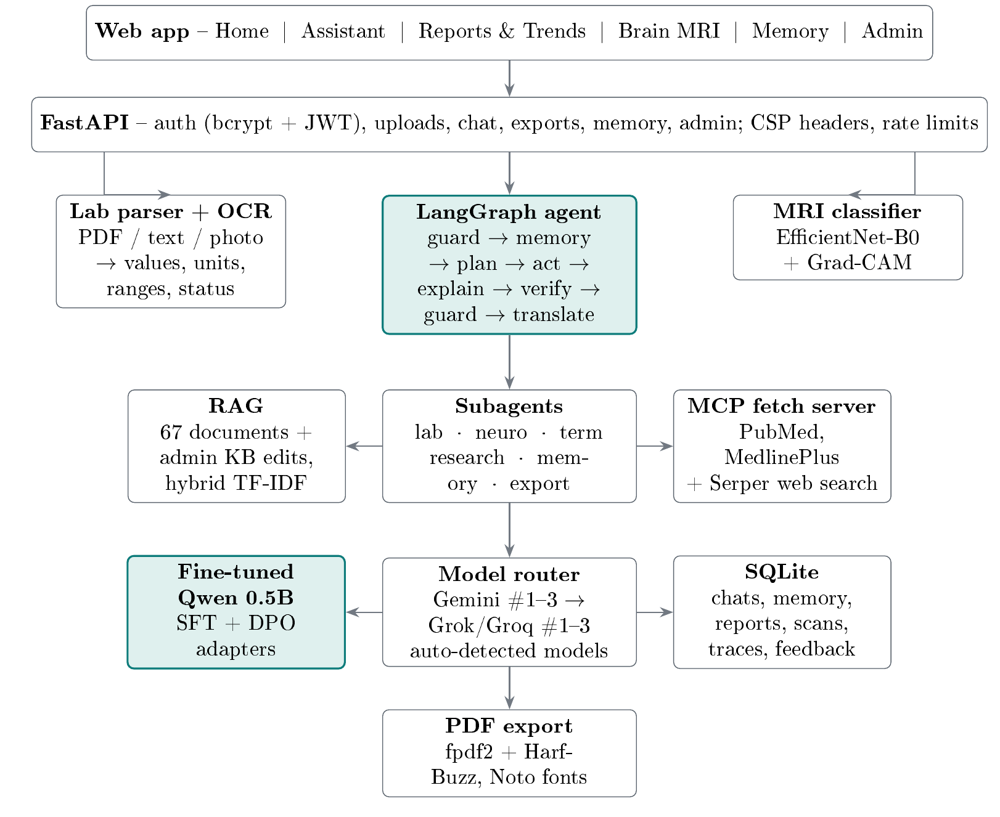
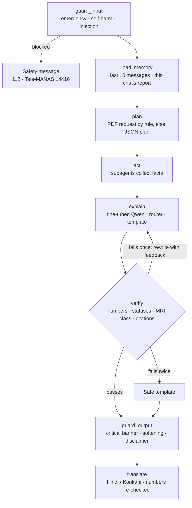
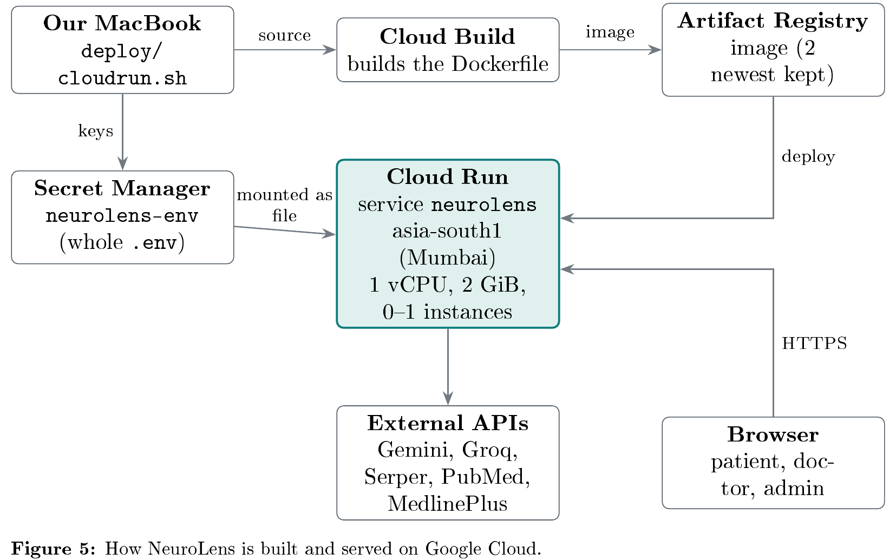

# Architecture

**Main idea:** tools produce the facts, the language model only explains them, and code checks every number before
the user sees the answer.

## Layers

| Layer | Code | Responsibility |
|---|---|---|
| Web app | `frontend/` (HTML, CSS, JS modules) | Home, Assistant, Reports and Trends, Brain MRI, Memory, Admin |
| HTTP | `backend/app/main.py`, `routers/` | Sign-in, ownership checks, rate limits, security headers; routers stay thin |
| Agent | `backend/app/agent/graph.py`, `subagents.py` | LangGraph agent with 8 steps and 6 subagents |
| Services | `backend/app/services/` | Lab parser, OCR, MRI, RAG, knowledge base, model router, explainer, translation, guardrails, verifier, memory, PDF, MCP, System Review |
| Data | `backend/app/models.py`, SQLite | Users, profiles, memory, chats, reports, scans, traces, feedback, exports, settings, KB edits |

## The agent

### Subagents

| Subagent | Uses | Returns |
|---|---|---|
| `lab_agent` | parsed report, RAG | abnormal and asked-about values, notes, patient and doctor templates |
| `neuro_agent` | MRI result, RAG, PubMed via MCP | class, probabilities, neuro notes, optional papers |
| `term_agent` | RAG → MedlinePlus via MCP → Serper | explanation of a medical term |
| `research_agent` | PubMed E-utilities via MCP | recent papers with links |
| `memory_agent` | database | saves a fact, only with consent |
| export (`_export`) | PDF service | download card for the report or scan in this chat |

## Model router

Six keys in order: Gemini #1–3, then Groq/xAI #1–3. Each key discovers its available models.

| Failure | Action |
|---|---|
| 404 model not found | next model on the same key |
| 429 quota | rest that model; next model on the same key |
| Timeout | skip that model on every key for this request |
| 5xx | rest the key for 60 s |
| 401 / 403 | rest the key for one hour |
| All fail | template answer |

Gemini is asked to think briefly (`thinkingLevel: low` / `thinkingBudget: 0`) so answers arrive within the timeout.

## Guardrails

| Stage | Guardrail |
|---|---|
| Input | Emergency (needs a personal, current context), self-harm, prompt injection, length limit; untrusted text wrapped as data |
| Tools | Photo or implausible reports go to a review step; colour photos rejected as MRI; MRI below 60% marked low confidence |
| Output | Diagnosis wording softened, doses removed, "stop your medicine" replaced, critical banner, disclaimer |
| Translation | Rejected if any number changes |
| Verifier | Numbers, statuses, MRI class and confidence, citations; one rewrite, then template |

## Memory

- **Short-term:** last 10 messages of the current chat; attachments belong to their own chat.
- **Long-term:** profile and report or scan summaries, saved only after the user turns memory on; deletable.

## Deployment

Docker image on Google Cloud Run (Mumbai, 1 vCPU, 2 GiB, 0–1 instances). The whole `.env` is one Secret Manager
secret mounted at `/secrets/neurolens.env`. See [DEPLOYMENT.md](DEPLOYMENT.md).
