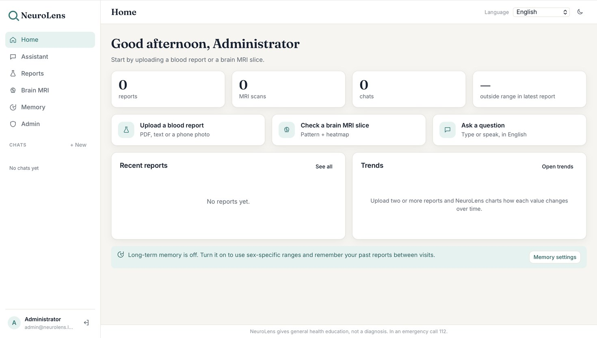
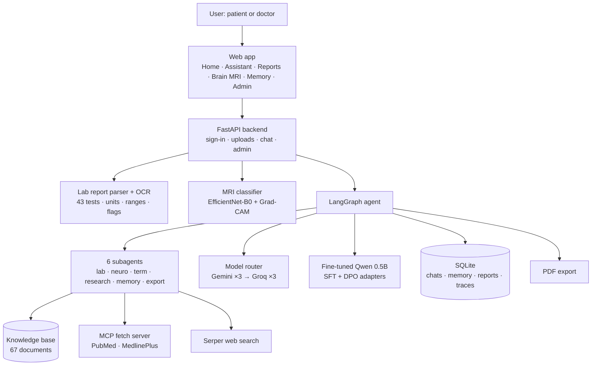
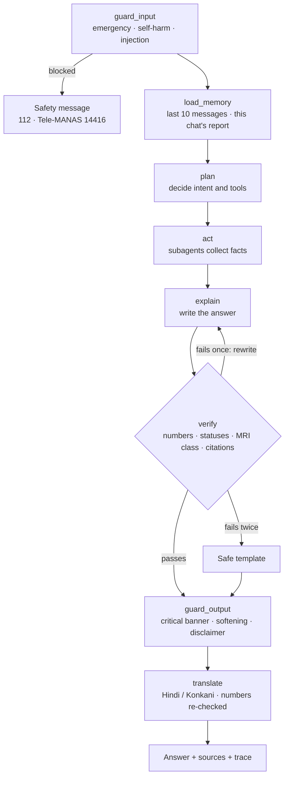
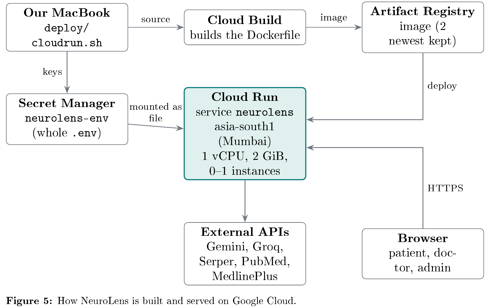
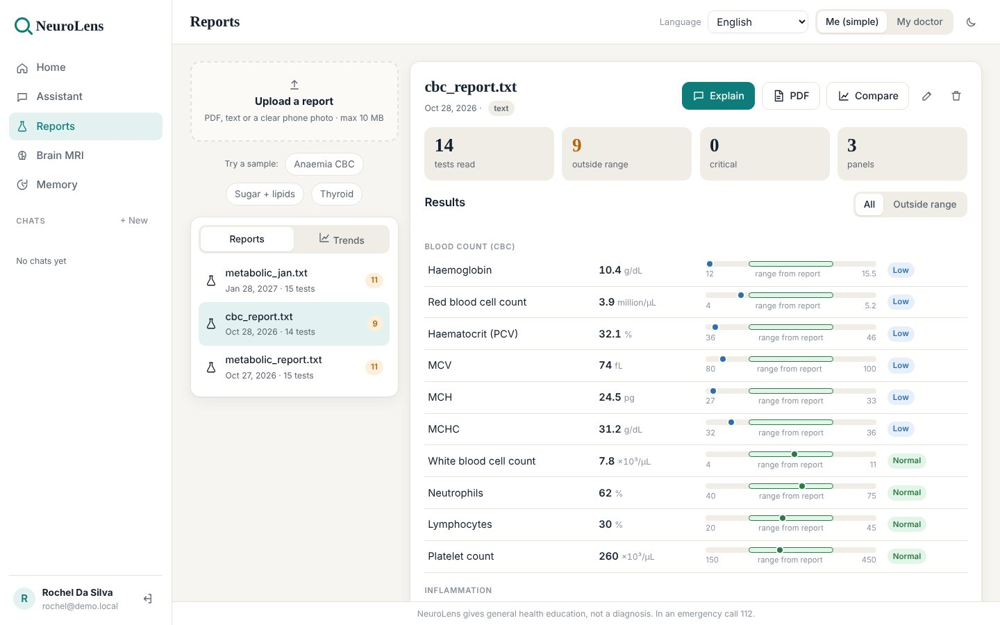
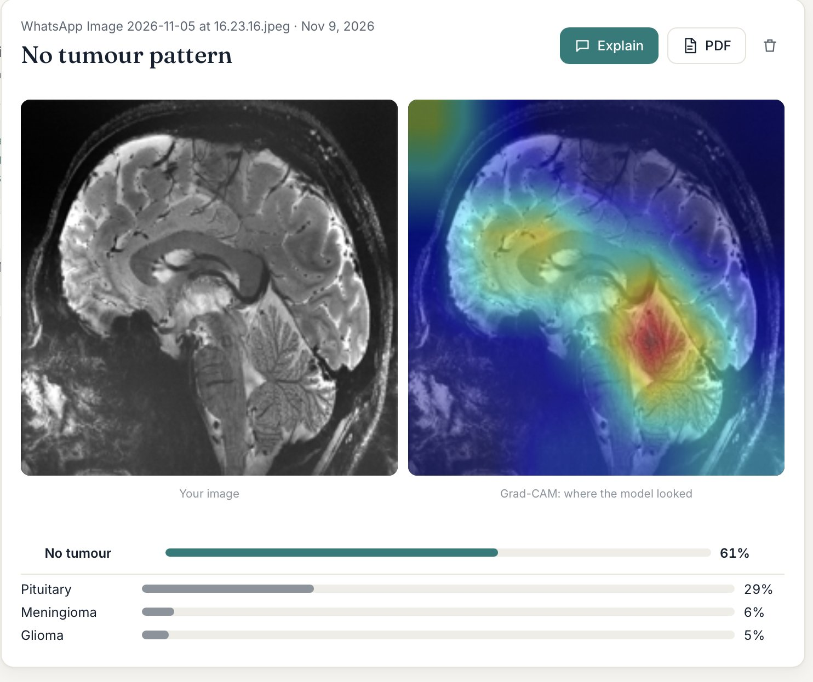
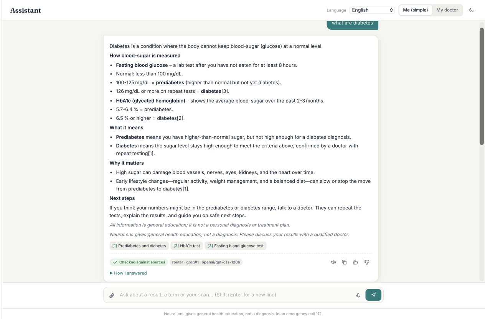
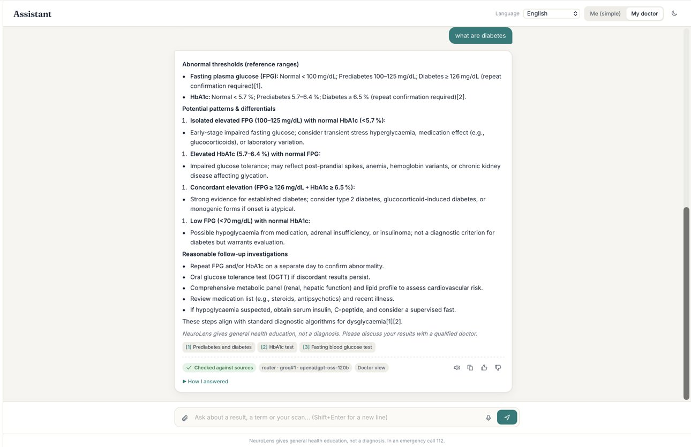
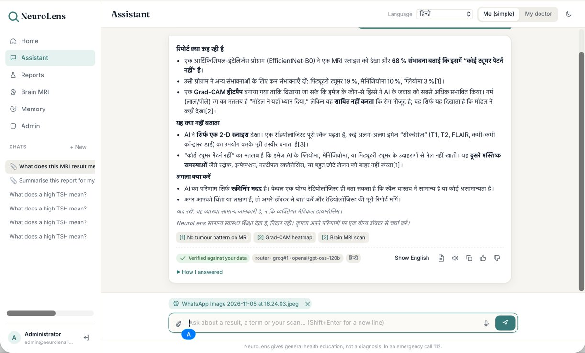
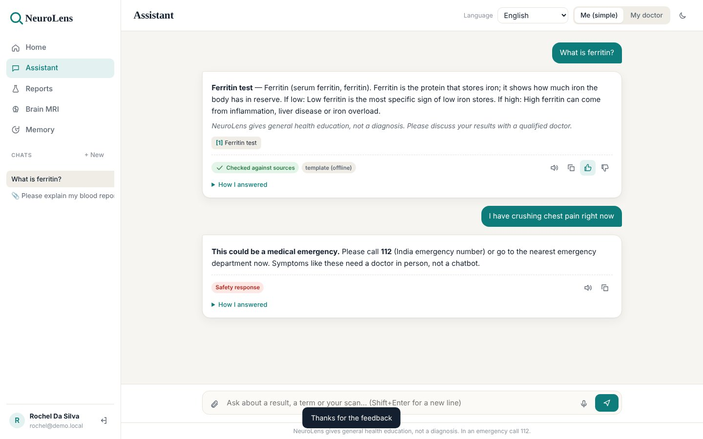

# NeuroLens 2 — An Agentic AI Assistant for Brain MRI Scans and Blood Reports

**Advanced AI Core Lab · M.Sc. Artificial Intelligence · Goa University · November 2026**

| Team member | Roll number |
|---|---|
| Kowsya Mutkundu | 25P0620007 |
| Muskan Khatoon | 25P0620012 |
| Rochel Ria Da Silva | 25P0620015 |

**Live app:** https://neurolens-pcpbqia5gq-el.a.run.app
**Project report:** [Project-Report.pdf](Project-Report.pdf) · **Slides:** [NeuroLens_2_Presentation.pptx](Documentation/NeuroLens_2_Presentation.pptx)



---

## The problem

Patients receive blood reports and brain MRI results full of numbers and medical terms they cannot read. General
chatbots explain them, but sometimes use the wrong number or sound like a diagnosis. In our LLM Engineering project,
our fine-tuned model became much easier to read (reading ease 52.6 → 64.6) but its factual accuracy stayed at 2.4/5.

**Our idea:** tools produce the facts, the language model only explains them, and code checks every number before
the user sees the answer.

## Features

| Feature | Details |
|---|---|
| Any lab report | PDF, text or phone photo; 43 tests in 9 panels; low, high and critical flags; review step for photos and implausible values |
| Brain MRI (neuro only) | EfficientNet-B0 classifier: glioma, meningioma, pituitary tumour, no tumour; Grad-CAM heatmap |
| Two audiences | "Me (simple)" for the patient, "My doctor" for a technical summary |
| Three languages | English, Hindi, Konkani (Romi); numbers re-checked after translation |
| PDF, trends, compare | Two-page PDF summary; charts across reports; changes since the last report |
| Voice | Speak a question; answers read aloud |
| Memory | Last 10 messages per chat; long-term memory only with consent; delete everything |
| Admin console | API-key status and tests, agent traces, feedback, knowledge-base editor, 15-check System Review |

The 9 panels: blood count (CBC), inflammation, diabetes, lipid profile, kidney function, electrolytes, thyroid, liver
function, vitamins and minerals.

## How it works

### System diagram



### Agent workflow



### Deployment diagram



**The agent** (LangGraph, 8 steps): if the verifier finds a wrong number, the answer is rewritten once with feedback;
if it fails again, a safe template built from the verified values is used.

**Six subagents:** lab (reads the report), neuro (reads the MRI result), term (explains medical words), research
(PubMed papers), memory (saves facts with consent), export (makes the PDF).

**Guardrails:** emergency and self-harm messages are stopped with a safety message (112, Tele-MANAS 14416); prompt
injection is refused; diagnosis wording is softened; medicine doses are removed; every answer and PDF carries a
disclaimer.

**Model router:** 3 Gemini + 3 Groq keys tried in order, with models detected automatically; if a key fails, the next
one answers.

## Three course areas

| Area | In NeuroLens |
|---|---|
| AI Engineering | FastAPI with deep service modules, 56 tests, evaluation suite, security headers, System Review, Docker and Cloud Run deployment |
| LLM Engineering | Qwen2.5-0.5B fine-tuned with SFT (QLoRA, rank 32, alpha 64) and DPO (lr 1e-5, beta 0.3) for patient-friendly explanations; six-key model router |
| Agentic AI | 8-step LangGraph agent, 6 subagents, short- and long-term memory, MCP (official fetch server for PubMed and MedlinePlus), RAG over 67 documents, guardrails, verifier |

## Technology stack

| Layer | Technology |
|---|---|
| Backend | Python, FastAPI, SQLAlchemy, SQLite, bcrypt, JWT |
| Agent and LLMs | LangGraph, Gemini, Groq |
| Fine-tuning | Qwen2.5-0.5B-Instruct, Transformers, PEFT, TRL, bitsandbytes (QLoRA), DPO |
| Vision and OCR | PyTorch, EfficientNet-B0, Grad-CAM, Gemini vision, Tesseract |
| Knowledge | TF-IDF hybrid retrieval, MCP fetch server, PubMed, MedlinePlus, Serper |
| Frontend | HTML, CSS, JavaScript modules, SVG charts, Web Speech API |
| Documents | pypdf, fpdf2, HarfBuzz, Noto Sans Devanagari |
| Deployment and testing | Docker, Google Cloud Run, Secret Manager, pytest |

## Results

| Measure | Result |
|---|---|
| Lab parser | 43/43 values and statuses correct |
| Verifier | 10/10 tampered answers caught, 0 false alarms |
| Guardrails | 18/18 test prompts handled correctly |
| Key failover | 99.8% of requests answered with 6 keys (65% with 1), each key failing 35% of the time |
| MRI classifier | test accuracy 95.25%, macro F1 0.951 |
| Fine-tuned LLM | reading ease 52.6 → 64.6, safety 4.23 → 5.00 (LLM judge, 1–5) |
| Automated tests | 56/56 pass |

Details: [Documentation/EVALUATION.md](Documentation/EVALUATION.md).

## Screenshots

| Lab report | Brain MRI with Grad-CAM |
|---|---|
|  |  |
| **Patient view** | **Doctor view** |
|  |  |
| **Hindi answer** | **Emergency guardrail** |
|  |  |

All screenshots: [Screenshots/](Screenshots/README.md).

## Repository layout

```
├── README.md              this file
├── Project-Report.pdf     full project report (50 pages)
├── Source-Code/           the application, training scripts, tests and deployment files
├── Documentation/         setup and deploy guides, architecture, design decisions, evaluation, slides
├── Screenshots/           version 1, version 2, the v2.1 fixes and the deployment
└── Demo/                  live link and demo steps
```

## Run it locally

```bash
cd Source-Code
cp .env.example .env        # add your Gemini, Groq and Serper keys
./run.sh                    # Windows: run.bat
```

Open http://localhost:8000. Full steps: [Documentation/SETUP.md](Documentation/SETUP.md).
Deploy to Google Cloud Run: [Documentation/DEPLOYMENT.md](Documentation/DEPLOYMENT.md).

The trained MRI model (`models/mri_classifier.pt`) and the fine-tuned adapters are not in the repository because of
their size.

---

*NeuroLens gives general health education, not a diagnosis. In an emergency, call 112.*
