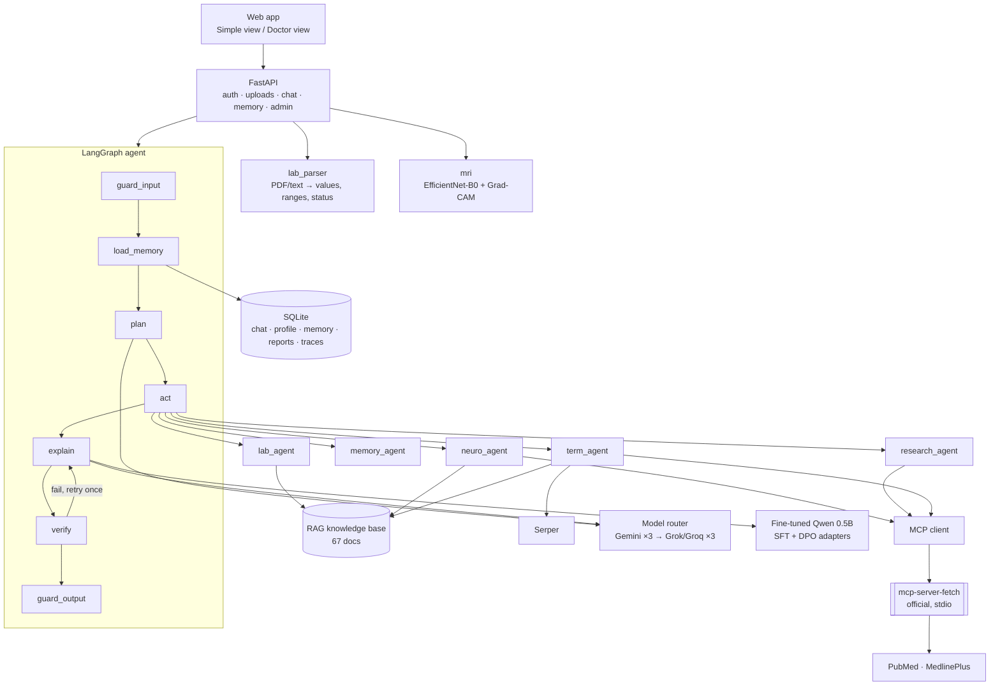

# Architecture

## Module boundaries (deep modules)

| Module | Public call | What it hides |
|---|---|---|
| `model_router` | `complete(system, messages, json_mode)` | 6 keys, two API formats, cooldowns, 404 model fallback, JSON validation |
| `lab_parser` | `parse_report(text, sex)` | 43 tests × aliases, unit conversion (mmol/L, µmol/L, lakh/cumm, cells/cumm), printed vs standard ranges, sex ranges, critical values |
| `mri` | `analyse(bytes)` | upload checks, greyscale guard, preprocessing, inference, Grad-CAM overlay |
| `rag` | `retrieve(query, k)` | corpus building, hybrid word + character TF-IDF (or dense embeddings if enabled) |
| `explainer` | `explain(question, facts, audience)` | local fine-tuned model vs router vs template, prompts |
| `verifier` | `verify_lab / verify_mri / verify_citations` | number grounding, status-word matching, confidence wording |
| `guardrails` | `check_input / check_output` | rule sets for emergencies, self-harm, injection, dosing, diagnosis |
| `memory` | `short_term / long_term / remember / forget_everything` | consent rules, limits, cascade deletion |
| `agent.graph` | `run_agent(...)` | the whole state machine, tracing, persistence |

## Neuro vs general scope

* **Neuro only:** MRI classifier (glioma, meningioma, pituitary, no tumour), Grad-CAM, neuro knowledge notes, PubMed research on the predicted pattern.
* **General (all specialties):** lab reports (CBC, iron, diabetes, lipids, kidney, electrolytes, thyroid, liver, vitamins, inflammation) and any medical term (knowledge base first, then MedlinePlus via MCP, then Serper).
